<p align="center">
  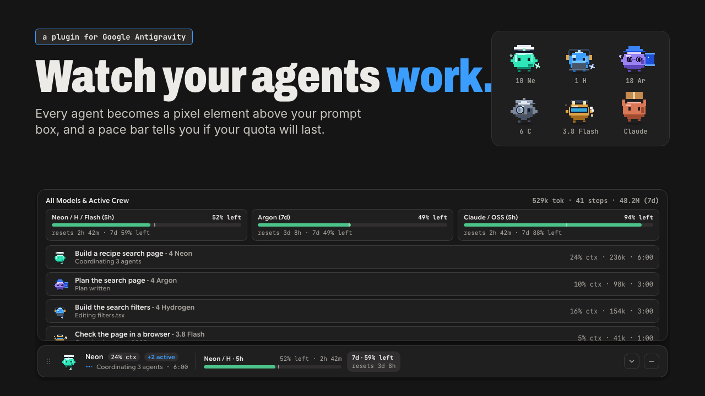
</p>

# Elemental Agent Panel for Google Antigravity


See what your Antigravity agents are doing and whether your quota will last, without leaving the chat. Every agent shows up as a small pixel element above your prompt box, and a bar tells you how much of your Gemini quota is left against how much time is left before it resets.

[Watch it work](#watch-it-work) · [What you get](#what-you-get) · [Meet the elements](#meet-the-elements) · [How to read it](#how-to-read-the-hud) · [Install](#install-it) · [How quota sync works](#how-quota-sync-works)

Sister project to [claude-agent-panel](https://github.com/mshadmanrahman/claude-agent-panel), which does the same for Claude Code.

## Watch it work

<p align="center">
  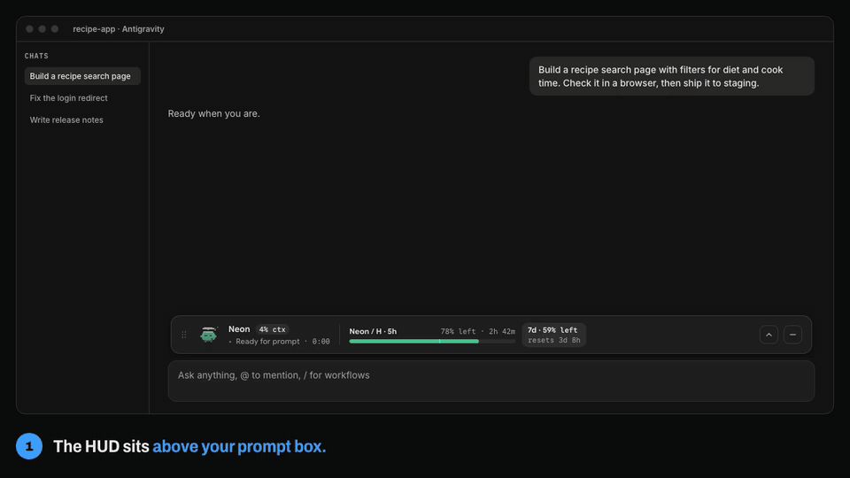
</p>

Eight steps, 25 seconds: a task goes from planning to shipped while the HUD tracks each agent. [Download the MP4](assets/demo.mp4) for the sharp version.

## What you get

| Piece | What it shows | Where you see it |
|---|---|---|
| **Elemental HUD** | Your main agent, how many helpers are working, and the quota bar for the model you picked | A small macOS window that sits right above the Antigravity prompt box |
| **Expanded HUD** | Every agent in the chat and every model's quota | Click the arrow on the HUD |
| **Quota dial** | Quota left, as a ring | Click the minus on the HUD |
| **Side panel** | All of the above plus tokens, context and cache per agent, and a 7-day view | Antigravity's right-hand pane, from the `+` menu |

<p align="center">
  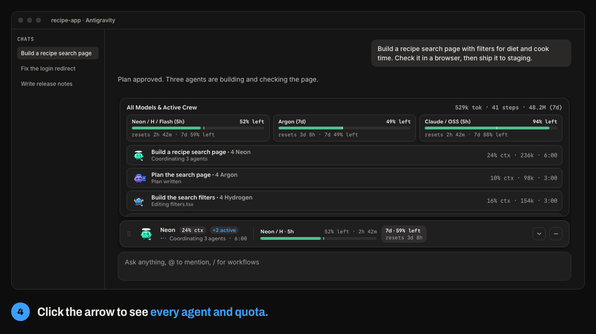
  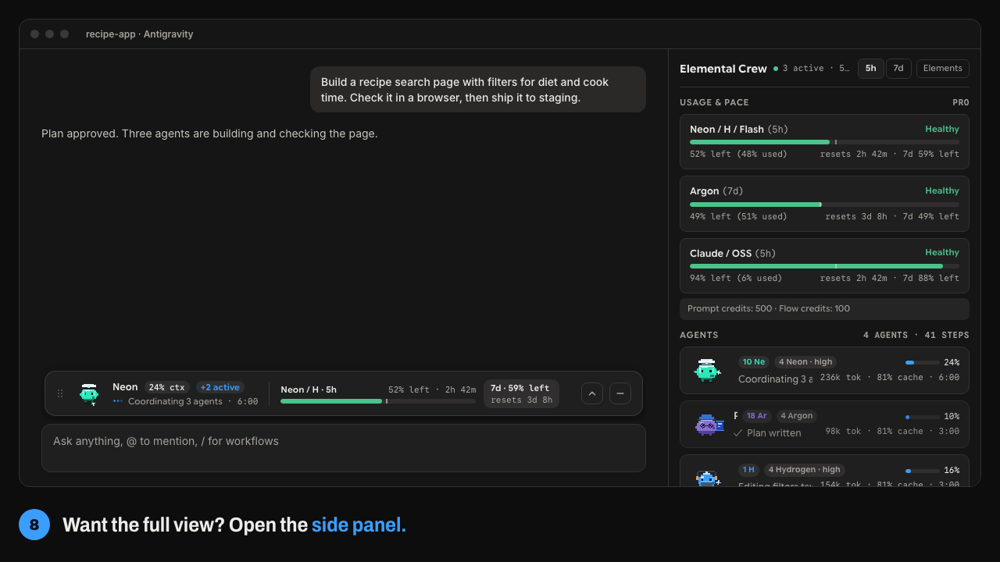
</p>

## Meet the elements

The element is picked by the model the agent runs on.

| | Element | Model |
|:---:|---|---|
| 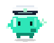 | **10 Ne, Neon** | Gemini 4 Neon and Orchestrator (Neon) |
| 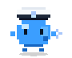 | **1 H, Hydrogen** | Gemini 4 Hydrogen |
| 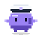 | **18 Ar, Argon** | Gemini 4 Argon and Orchestrator (Argon) |
| 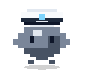 | **6 C, Carbon** | Gemini 4 Carbon |
| 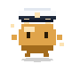 | **3.8 Flash** | Gemini 3.8 Flash |
| 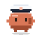 | **Guest** | Claude, GPT and open models |

The outfit is picked by the job the agent was given.

|  | 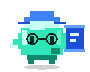 | 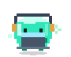 | 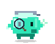 | 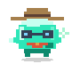 | 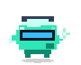 | 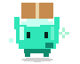 |
|:---:|:---:|:---:|:---:|:---:|:---:|:---:|
| Coordinator | Architect | Builder | Reviewer | Scout | Browser | Shipper |

And the face tells you the state.

|  | 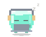 | 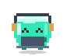 | 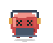 |
|:---:|:---:|:---:|:---:|
| Working | Waiting for you | Done | Failed |

## How to read the HUD

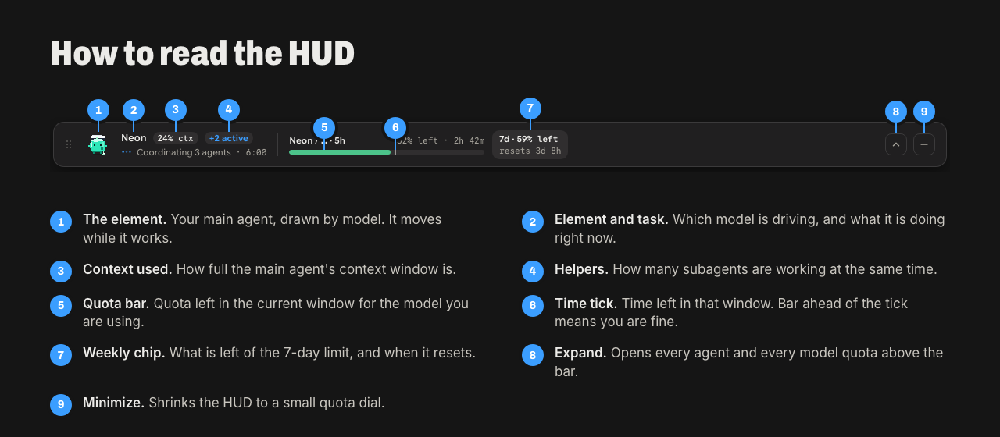

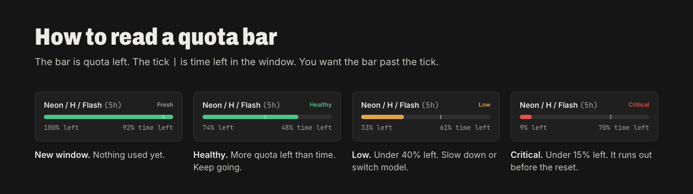

The badge on each card goes by quota left: under 40% turns it amber, under 15% turns it red.

## Install it

You need a Mac, Google Antigravity (signed in, with a chat open), Node.js, and Xcode command line tools for the HUD. The side panel alone works anywhere Antigravity runs.

### The lazy way: let Antigravity do it

Open a chat in Antigravity, paste this, and press Enter. Allow the commands when it asks.

```text
Install the Elemental Agent Panel for me. Clone github.com/mshadmanrahman/antigravity-agent-panel into ~/.gemini/config/plugins/antigravity-agent-panel, then run bash ~/.gemini/config/plugins/antigravity-agent-panel/hud/build-hud.sh and open "$HOME/Applications/Elemental HUD.app". Tell me when it says Built.
```

### The Terminal way

**Step 1.** Get the plugin.

```bash
git clone https://github.com/mshadmanrahman/antigravity-agent-panel ~/.gemini/config/plugins/antigravity-agent-panel
```

**Step 2.** Build the HUD. It ends with a `Built` line.

```bash
bash ~/.gemini/config/plugins/antigravity-agent-panel/hud/build-hud.sh
```

**Step 3.** Open it.

```bash
open -a "$HOME/Applications/Elemental HUD.app"
```

Already have a checkout somewhere else? Link it instead of Step 1:

```bash
ln -sfn /path/to/antigravity-agent-panel ~/.gemini/config/plugins/antigravity-agent-panel
```

## Did it work?

1. Restart Antigravity and open a chat.
2. Look right above the prompt box. You should see your element and a quota bar.
3. For the side panel, click `+` in the right-hand pane and pick **Elemental Agent Panel**.

## Something went wrong

| What you see | What to do |
|---|---|
| `xcrun: error` or `swiftc: command not found` | Run `xcode-select --install`, wait for it to finish, then run Step 2 again. |
| The HUD says "Waiting for Antigravity chat..." | Open a chat and send any message. The HUD needs a running language server. |
| The quota bar is missing | The HUD could not reach the language server. Restart Antigravity with a chat open. |
| The HUD is gone | It hides when Antigravity loses focus. Click back into Antigravity. |
| No **Elemental Agent Panel** in the `+` menu | Check the folder is at `~/.gemini/config/plugins/antigravity-agent-panel`, then restart Antigravity. |

Still stuck? [Open an issue](https://github.com/mshadmanrahman/antigravity-agent-panel/issues/new) with a screenshot.

## Get the newest version

```bash
git -C ~/.gemini/config/plugins/antigravity-agent-panel pull && bash ~/.gemini/config/plugins/antigravity-agent-panel/hud/build-hud.sh
```

## Remove it

```bash
rm -rf ~/.gemini/config/plugins/antigravity-agent-panel "$HOME/Applications/Elemental HUD.app"
```

---

## How it works

The backend (`sidecars/agent_panel/main.mjs`) runs inside Antigravity's `SidecarApp` or standalone on `127.0.0.1:47812` when launched by `Elemental HUD.app`:

- Queries `LanguageServerService/GetUserStatus` and `GetAllCascadeTrajectories` on the active daemon port (`~/.gemini/antigravity/daemon/hub_*.json`).
- Reads `brain/<conversationId>/.system_generated/logs/transcript.jsonl` (and `swarm/members.json`) across `~/.gemini/antigravity`, `~/.gemini/antigravity-ide`, and `~/.gemini/antigravity-cli`.
- Persists 5h quota cycle snapshots to `~/.gemini/antigravity/sidecar_data/antigravity-agent-panel/weekly-ledger.json` so `7d Weekly` stays accurate across resets.

## How quota sync works

Antigravity's language server already knows your quota. The panel asks it rather than guessing.

1. **Find the server.** Each running Antigravity flavor writes a daemon file under `~/.gemini/antigravity*/daemon/*.json` with an `httpPort` and a `csrfToken`. The backend reads those and calls the server on `127.0.0.1` with the token in the `x-codeium-csrf-token` header. The panel itself makes no network calls beyond that local server.
2. **Ask for the summary.** `LanguageServerService/RetrieveUserQuotaSummary` returns quota groups, each holding one or more buckets with a remaining fraction and a reset time. The panel sorts groups into three pools: Argon, Claude / OSS, and Neon / H / Flash.
3. **Split the windows.** A bucket whose `window` is `weekly` (or whose id contains `weekly`) is the 7-day bucket. Everything else is the rolling 5-hour bucket. Each pool shows its own native window, so Argon reads `7d` while Neon / H / Flash reads `5h`, and the meta line carries the other one.
4. **Work out the pace.** For each bucket, `pace = % used / % of window elapsed`. The verdict follows from that number:

   | Pace | Verdict |
   |---|---|
   | under 0.2% used | Fresh |
   | below 0.85 | Under pace |
   | 0.85 to 1.0 | On pace |
   | above 1.0 | Ahead of pace |
   | above 1.15 | Over pace |

   The verdict ships in `/api/panel` for scripts. The cards and the HUD show a simpler badge by quota left (fresh, healthy, low, critical), and the tick on each bar marks where usage would sit if you spent evenly across the window.
5. **Fall back when needed.** If the summary call fails, the panel reads `GetUserStatus` instead and groups each model's `quotaInfo` by reset time. You lose the weekly split but keep the 5-hour numbers.
6. **Keep a ledger.** Every 5-hour snapshot is written to `weekly-ledger.json` in the sidecar data folder, so the `7d` view survives resets and app restarts. Token totals for the same 7 days come from each conversation's `transcript.jsonl`.

The standalone server listens on `127.0.0.1` only, sends no CORS headers, and rejects any request whose `Host` is not `127.0.0.1` or `localhost`, so a web page can't read your chat titles through DNS rebinding.

## Rebuild the images and video

Everything in `assets/` is rendered from the real HUD and panel code against a fixture, so no private chat shows up. Run `python3 assets/src/build.py` (needs Chrome and ffmpeg).

## License

[MIT](LICENSE)
