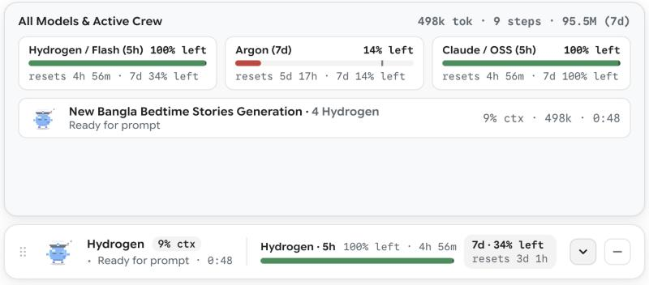
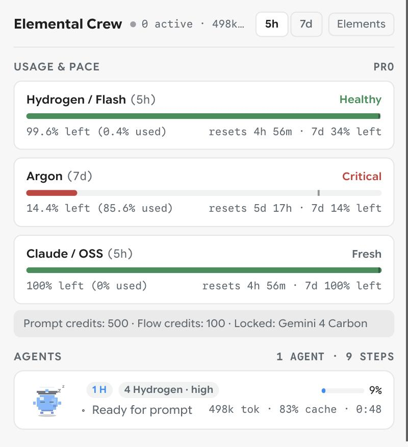

# Elemental Agent Panel for Google Antigravity

A live Auxiliary Pane plugin and floating macOS HUD bar for **Google Antigravity**. Watch your active agents work as animated periodic-table elements right above your prompt input bar or in the side pane, track token and context usage per conversation and subagent, and toggle between native reset windows (`5h`/`7d`) and a 7-day rolling view.

Sister project to [claude-agent-panel](https://github.com/mshadmanrahman/claude-agent-panel).





## Two ways to view it

1. **Floating Above-Chat HUD (`Elemental HUD.app` on macOS):**
   Antigravity has no plugin hook inside the prompt box, and closing the right-hand Auxiliary Pane hides sidecar tabs. `Elemental HUD.app` snaps to your active chatbox width and anchors right above it (gliding upward automatically as multiline prompts grow), tracks Antigravity's model dropdown live across `antigravity`, `antigravity-ide`, and `antigravity-cli`, auto-hides when Antigravity loses focus, and minimizes into a circular quota dial beside the chatbox.
2. **Auxiliary Pane Sidecar (`Agent Panel`):**
   Opens natively inside Antigravity's right-hand pane from the `+` menu (or a `sidecar://antigravity-agent-panel/agent_panel/` link).

## What it shows

- **Elemental characters (Model x Persona x State):**
  - **1 H (Hydrogen):** Airy Gemini Blue (`#078EFA` light / `#3B9EFF` dark) with an orbiting four-point spark.
  - **18 Ar (Argon):** Noble-gas containment shell for `Gemini 4 Argon` and `Orchestrator (Argon)`.
  - **6 C (Carbon):** Faceted crystalline core for `Gemini 4 Carbon`.
  - **3.8 Flash:** Electric spark sprite for `Gemini 3.8 Flash`.
  - **Claude / OSS:** Terracotta guest atom when switching to non-Gemini models.
- **Role personas:** Coordinator, Architect, Builder, Reviewer, Scout, Browser, and Shipper animations driven by subagent roles and live tool calls.
- **Usage & Pace:** Each model displays its native reset window automatically (`5h` rolling for Hydrogen/Flash and Claude/OSS, `7d` weekly for Argon) with `% used` vs. `% elapsed` pace verdicts, while the expanded drawer shows all model pools and passive 7-day token totals.
- **Context & Tokens:** Real-time context fill percentage, total tokens, cache hit rate, and elapsed active time read from each conversation's `transcript.jsonl`.

## Install locally

```bash
git clone https://github.com/mshadmanrahman/antigravity-agent-panel ~/.gemini/config/plugins/antigravity-agent-panel
```

Or symlink an existing checkout:

```bash
ln -sfn /path/to/antigravity-agent-panel ~/.gemini/config/plugins/antigravity-agent-panel
```

### Build and launch the floating macOS HUD

```bash
bash ~/.gemini/config/plugins/antigravity-agent-panel/hud/build-hud.sh
open -a "$HOME/Applications/Elemental HUD.app"
```

## Requirements

- macOS (the floating HUD is a Swift app; the side-pane plugin runs anywhere Antigravity does)
- Google Antigravity, signed in, with at least one chat open so a language server is running
- Node.js installed in `/opt/homebrew/bin`, `/usr/local/bin` or `/usr/bin` (the HUD looks there to start the backend)
- Xcode command line tools to build the HUD (`xcode-select --install`)

## How it works

The backend (`sidecars/agent_panel/main.mjs`) runs inside Antigravity's `SidecarApp` or standalone on `127.0.0.1:47812` when launched by `Elemental HUD.app`:

- Queries `LanguageServerService/GetUserStatus` and `GetAllCascadeTrajectories` on the active daemon port (`~/.gemini/antigravity/daemon/hub_*.json`).
- Reads `brain/<conversationId>/.system_generated/logs/transcript.jsonl` (and `swarm/members.json`) across `~/.gemini/antigravity`, `~/.gemini/antigravity-ide`, and `~/.gemini/antigravity-cli`.
- Persists 5h quota cycle snapshots to `~/.gemini/antigravity/sidecar_data/antigravity-agent-panel/weekly-ledger.json` so `7d Weekly` stays accurate across resets.

## How quota sync works

Antigravity's language server already knows your quota. The panel asks it rather than guessing.

1. **Find the server.** Each running Antigravity flavor writes a daemon file under `~/.gemini/antigravity*/daemon/*.json` with an `httpPort` and a `csrfToken`. The backend reads those and calls the server on `127.0.0.1` with the token in the `x-codeium-csrf-token` header. The panel itself makes no network calls beyond that local server.
2. **Ask for the summary.** `LanguageServerService/RetrieveUserQuotaSummary` returns quota groups, each holding one or more buckets with a remaining fraction and a reset time. The panel sorts groups into three pools: Argon, Claude / OSS, and Hydrogen / Flash.
3. **Split the windows.** A bucket whose `window` is `weekly` (or whose id contains `weekly`) is the 7-day bucket. Everything else is the rolling 5-hour bucket. Each pool shows its own native window, so Argon reads `7d` while Hydrogen reads `5h`, and the meta line carries the other one.
4. **Work out the pace.** For each bucket, `pace = % used / % of window elapsed`. The verdict follows from that number:

   | Pace | Verdict |
   |---|---|
   | under 0.2% used | Fresh |
   | below 0.85 | Under pace |
   | 0.85 to 1.0 | On pace |
   | above 1.0 | Ahead of pace |
   | above 1.15 | Over pace |

   The tick on each bar marks where usage would sit if you spent evenly across the window.
5. **Fall back when needed.** If the summary call fails, the panel reads `GetUserStatus` instead and groups each model's `quotaInfo` by reset time. You lose the weekly split but keep the 5-hour numbers.
6. **Keep a ledger.** Every 5-hour snapshot is written to `weekly-ledger.json` in the sidecar data folder, so the `7d` view survives resets and app restarts. Token totals for the same 7 days come from each conversation's `transcript.jsonl`.

The standalone server listens on `127.0.0.1` only, sends no CORS headers, and rejects any request whose `Host` is not `127.0.0.1` or `localhost`, so a web page can't read your chat titles through DNS rebinding.

## License

[MIT](LICENSE)
